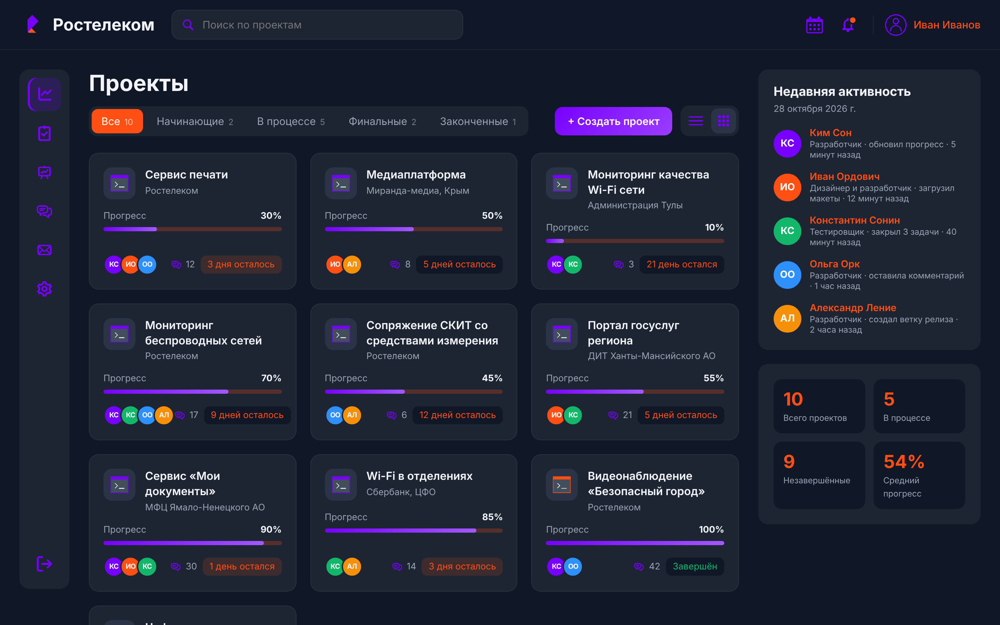
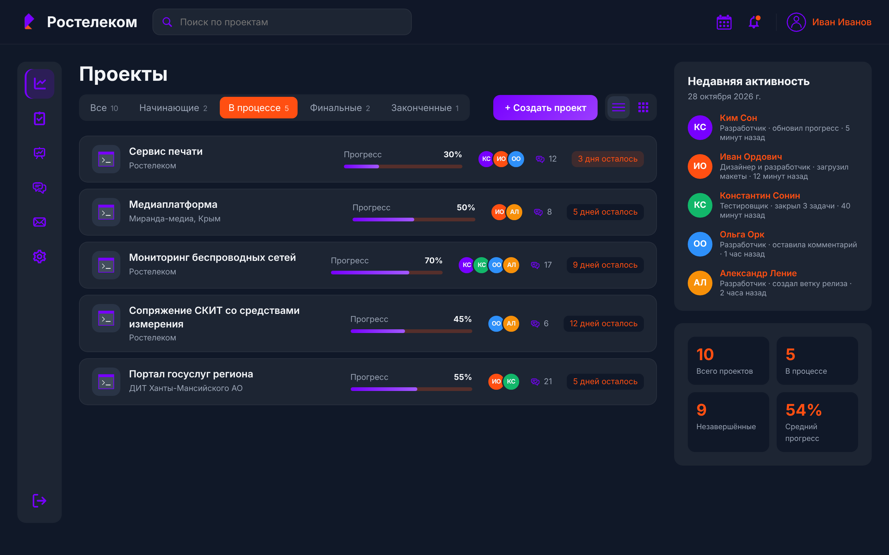
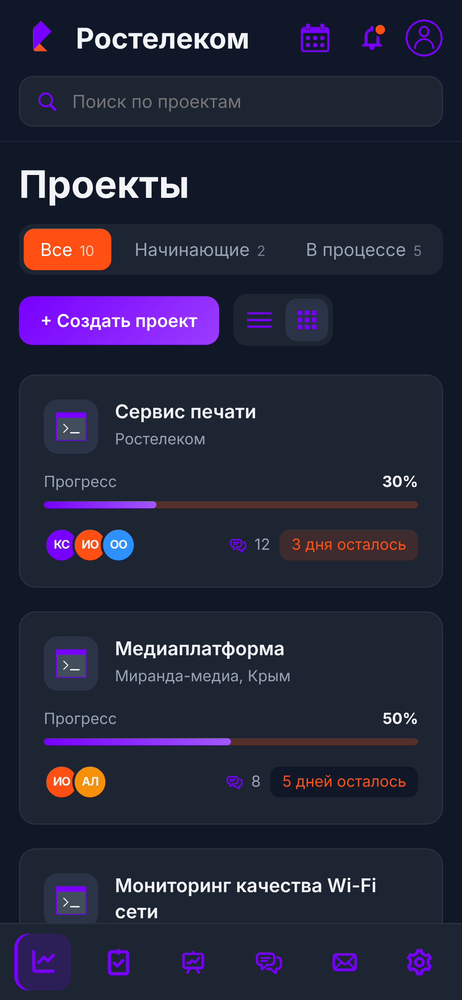
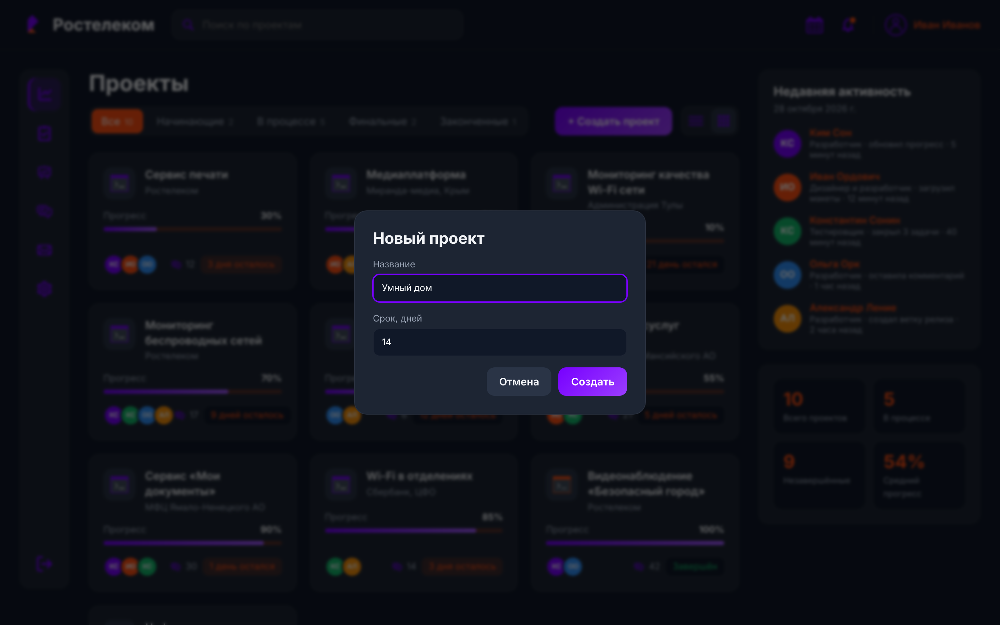

# Дашборд проектов

Интерактивный дашборд для управления портфелем проектов в фирменном стиле «Ростелекома». Работает без фреймворков и сборки: чистые HTML, CSS и JavaScript.



## Возможности

- **Фильтр по статусам** (начинающие, в процессе, финальные, законченные) со счётчиками
- **Мгновенный поиск** по названию проекта и заказчику
- **Два вида отображения**: плитка и список
- **Создание проекта** через модальное окно; проекты сохраняются в `localStorage`
- **Карточки проектов**: прогресс, команда, число сообщений, срок; срочные дедлайны подсвечиваются
- **Лента активности команды** и **сводная статистика**, которая пересчитывается на лету
- **Адаптивная вёрстка**: на телефоне меню переезжает в нижнюю панель, фильтры прокручиваются горизонтально

| Список с фильтром | Мобильная версия |
|---|---|
|  |  |



## Технологии

- HTML5: семантическая разметка, нативный `<dialog>`
- CSS: Grid и Flexbox, CSS-переменные, тёмная тема, адаптив на media queries
- Vanilla JavaScript: данные отрисовываются из массива, состояние фильтров и поиска хранится в одном объекте

## Запуск

Откройте `index.html` в браузере. Демо на GitHub Pages: Settings → Pages → Deploy from a branch → `main` / `root`.

## Структура

```
index.html   разметка
styles.css   стили и адаптив
app.js       данные и логика: фильтры, поиск, вид, создание проектов
icons/       иконки интерфейса
docs/        скриншоты
```
