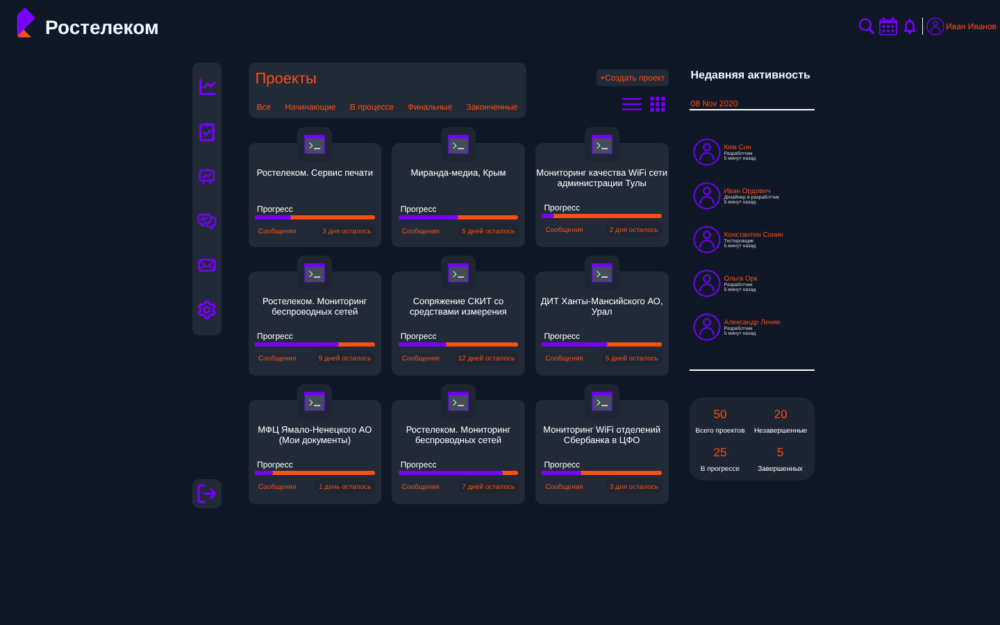

# Дашборд проектов

Вёрстка дашборда для управления проектами в фирменном стиле «Ростелекома»: карточки проектов с прогрессом и дедлайнами, фильтр по статусам, лента активности команды и сводная статистика.



## Что на экране

- **Шапка**: логотип, поиск, календарь, уведомления, профиль пользователя
- **Боковое меню**: аналитика, задачи, отчёты, сообщения, почта, настройки
- **Проекты**: сетка карточек с названием, прогресс-баром, ссылкой на обсуждение и счётчиком оставшихся дней; фильтры «Все / Начинающие / В процессе / Финальные / Законченные», переключение списка и сетки
- **Недавняя активность**: участники команды с ролями и временем последнего действия
- **Статистика**: всего проектов, в процессе, незавершённые, завершённые

## Технологии

Чистые HTML и CSS без фреймворков и сборки: Flexbox-раскладка, тёмная тема, фирменная палитра (фиолетовый `#7700FF`, оранжевый `#FF4F12`).

## Запуск

Откройте `index.html` в браузере. Для GitHub Pages: Settings → Pages → Deploy from a branch → `main` / `root`.

## Структура

```
index.html     разметка
main.css       раскладка и компоненты
rostelec.css   фирменные цвета и типографика
icons/         иконки интерфейса
docs/          скриншоты
```
